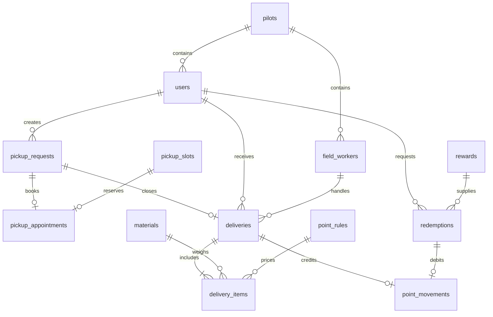

# Contrato PostgreSQL de EcoConecta

## Estado y migraciones

Esta copia proviene de un ZIP sin `.git` ni migraciones previas. `db/migrations/001_initial.sql` es la primera migración de esta base. Si existe una base externa con una migración inicial ya aplicada, se debe comparar su esquema y agregar una migración incremental; no se debe aplicar `001_initial.sql` encima ni modificar su historial. `db/migrate.py` aplica SQL en orden, registra SHA-256 y aborta si una migración aplicada cambió.

PostgreSQL 13 o superior; `psycopg` 3. Variables: `DATABASE_URL` para desarrollo/Neon y `TEST_DATABASE_URL` para pruebas aisladas. No se publican valores. Instalar: `python -m pip install -r db/requirements.txt`. Migrar: `python -m db.migrate`; para prueba: `python -m db.migrate --test`. En Docker local usar la URL del contenedor publicada al host en `DATABASE_URL`. En Neon usar la URL PostgreSQL TLS en la misma variable. `db/demo.sql` contiene identidades y premios ficticios; ejecutar con `psql "$DATABASE_URL" -v ON_ERROR_STOP=1 -f db/demo.sql` solo en una base descartable. Los precios y puntos requieren validación del equipo antes de producción.

## Modelo y referencias

Todos los identificadores de negocio son UUID. `users` autentica con `password_hash`; roles `cliente`, `lider`, `admin`. La cédula (`document_number`) es obligatoria para cliente y única cuando existe. `field_workers` guarda el responsable de campo sin cuenta. `deliveries.closed_by_id` guarda por separado a la líder que confirmó. `pilots` define zona, ciudad y zona horaria. `content_entries` contiene borradores, publicaciones y archivo. Solicitudes `pickup_requests` usan `recibida`, `programada`, `recolectada`, `cancelada` y `revision`; `pickup_notices` y `request_audit` conservan mensajes y cambios. Una cita completa es una fila de `pickup_appointments` con solicitud, turno y líder obligatorios. Las claves compuestas impiden cruzar pilotos entre solicitud, turno, avisos, auditoría, cliente, responsable y premio. Una plaza admite una cita.

`pickup_slots.starts_at/ends_at`, cierres, auditoría y publicaciones son `timestamptz`; la API convierte a `America/Bogota` para el cliente en Barranquilla. `deliveries` representa tanto cierres de solicitud (`kind='pickup'`, `request_id` único) como entregas directas (`kind='direct'`, `external_key` único). **Formato de materiales por entrega:** lista JSON de `{ "material_id": "UUID", "weight_kg": "1.250" }`, un elemento por material. El decimal usa kilogramos, hasta tres cifras, rango 0.001–10000. Cada línea persiste `rule_id`, `points_per_kg` y `awarded_points`; se trunca hacia abajo por línea y se suma. La regla vigente es la última por `valid_from` que cubra el instante de cierre. Reglas superpuestas se resuelven por esa prioridad; los cambios de tarifa se hacen con nuevas filas. Se exige al menos un punto total por cierre.

`point_movements` es el libro inmutable. Cada abono referencia exactamente una entrega y cada débito un canje. La unicidad de `delivery_id` y `redemption_id` impide duplicar movimientos. Un disparador comprueba el importe frente a las líneas o al precio del canje, actualiza `users.points_balance` y rechaza saldo negativo; otro protege el saldo de escrituras directas. El saldo se puede comprobar con `sum(point_movements.amount)` por cliente. `redemptions.points_cost` conserva el precio confirmado; un disparador comprueba el precio y consume una unidad de `rewards.stock`, siempre dentro de la transacción. El código de canje es globalmente único.

## APIs internas y límites transaccionales

`db.connection.open_connection(database_url)` entrega una conexión `psycopg` para módulos que necesiten persistencia; la configuración global debe suministrar la URL. `db.operations.close_pickup(database_url, request_id, actor_id, field_worker_id, items) -> (delivery_id, points)` bloquea la solicitud, exige cita y estado `programada`, valida líder y responsable activos del piloto, inserta entrega, materiales, abono y auditoría en una transacción. Repetir la solicitud devuelve el mismo cierre y puntos. `record_direct_delivery(database_url, client_id, actor_id, field_worker_id, external_key, items)` hace lo mismo sin solicitud; el cliente genera y conserva `external_key` para reintentos. `confirm_redemption(database_url, client_id, reward_id, code) -> (redemption_id, points_cost)` bloquea cliente y premio, comprueba saldo y stock, guarda el precio, descuenta una unidad y debita en una transacción. Repetir el mismo código, cliente y premio devuelve el canje original; reutilizarlo para otro da error. Cualquier error de PostgreSQL revierte toda la operación. Las rutas de otros responsables deben llamar estas funciones, no escribir el libro directamente.

Las funciones lanzan `DomainError` para estados o datos de negocio y dejan los errores de integridad de `psycopg` al adaptador HTTP. Contrato HTTP pendiente con Codex 1/2: propuesto 400 para datos inválidos, 404 para identificador no visible, 409 para estado, saldo, stock o código en conflicto, cuerpo `{ "error": { "code": "...", "message": "..." } }`. La autenticación y la autorización de visibilidad siguen en la capa API. La asignación por turno y el cierre delegado esperan validación del jurado; este módulo exige una líder activa del mismo piloto para cerrar.

## Verificación

`python -m unittest discover -s db/tests -v` crea un esquema temporal dentro de `TEST_DATABASE_URL`, corre migración y lo elimina. Nunca usa `DATABASE_URL` como sustituto. Cubre instalación limpia, restricciones, rollback, idempotencia y concurrencia. La integración con routers ajenos queda para la integración de ramas.

Desde una terminal con acceso a Docker e Internet, `bash db/verify_and_publish.sh` crea un PostgreSQL temporal, instala la dependencia, ejecuta las pruebas, publica `feat/backend-base-datos` y comprueba que el SHA remoto coincide. Si ya existe una base PostgreSQL aislada, configurar `TEST_DATABASE_URL` antes de ejecutarlo; en ese caso no inicia Docker. Nunca apuntar `TEST_DATABASE_URL` a una base de desarrollo o producción.
